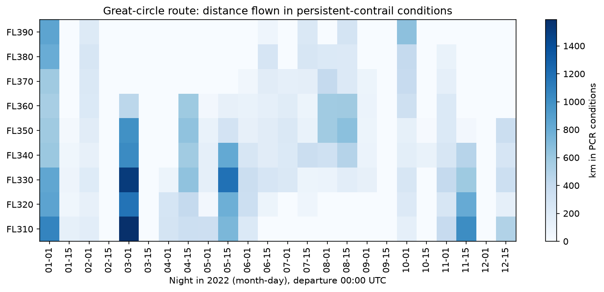
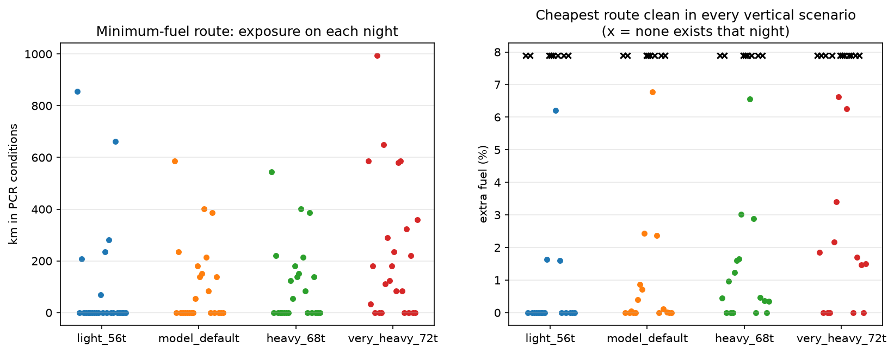
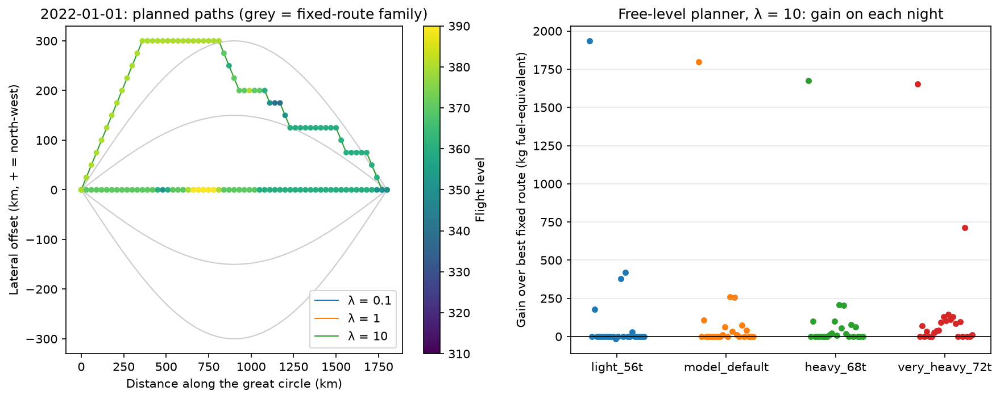

# robust-contrail-routing

[](https://github.com/bunluy/robust-contrail-routing/actions/workflows/tests.yml)

**How should an aircraft's cruise level and path be chosen to avoid creating persistent contrails, when the weather data behind that choice is uncertain, and what does planning for that uncertainty cost?**

An independent case study using ERA5 atmospheric reanalysis, the open-source contrail model [pycontrails](https://py.contrails.org) and the Poll–Schumann aircraft performance model. It evaluates 45 candidate routes for an A320-class flight under 18 weather-error scenarios and compares deterministic and robust ways of choosing between them.

> **Status:** Sessions 1–9 complete. One night (2022-03-01) studied in detail, the analysis repeated on 24 nights of 2022, and a route planner compared with the fixed route set. Next: a robust planner with a C++ search core, then checking the weather-error assumptions against humidity measured on board airliners (IAGOS). See [Roadmap](#roadmap).

---

## Main findings

*Case study: a ~1,800 km night flight from (−10°, 45°) to (10°, 55°), A320, constant true airspeed 230 m/s, no wind, 45 candidate routes. Repeated on 24 nights of 2022 (the 1st and 15th of each month, 00:00 UTC), a rule fixed before any results were seen; 2022-03-01 is studied in the most detail.*

**1. Persistent-contrail conditions at cruise levels are common, and their height changes from night to night.** Every night had persistent-contrail (PCR) conditions on at least one route. On all six summer nights they reached FL370 or higher; on no spring night did they rise above FL360; winter and autumn were mixed. Climbing is therefore not a universal fix: the great-circle route at FL390 was itself exposed on 6 nights.



**2. Aircraft weight decides how often there is a trade-off.** Heavier aircraft cruise most efficiently lower down, closer to or inside the moist layer:

| Start-of-cruise mass | Most fuel-efficient level | Nights its route is exposed | ...or would be under a 150–600 m error in the layer's height |
|---|---|---|---|
| 56 t | FL390 | 6 of 24 | 11 of 24 |
| ≈64 t (model estimate) | FL370–FL380 | 11 of 24 | 17 of 24 |
| 68 t | FL360–FL370 | 12 of 24 | 19 of 24 |
| 72 t (near maximum) | FL350–FL360 | 17 of 24 | 19 of 24 |

**3. Avoidance is often affordable, but its cost varies widely between nights.** At the model-estimate mass, cutting exposure by at least 80% cost a median 1.2% extra fuel (up to 4.8%; not possible on 1 night). With the aircraft held at or below FL360, it cost a median 4.3% (up to 13.1%; not possible on 3 of 15 nights). The single-night figure that started this (an 83% cut for 1.6% on 2022-03-01) was at the cheap end.


**4. Uncertainty in the *height* of the moist layer changes route choices on most nights.** With the weather field shifted up or down by 150–600 m, deterministic, worst-case and minimum-regret rules chose different routes in 142 of 288 cases, on 19 of 24 nights. On 2022-03-01, height errors changed decisions far more often (9 of 12 cases) than uniform humidity errors (1 of 9) or horizontal and timing errors (1 of 18).

**5. A robust plan is usually cheap, but not always available.** The worst-case choice cost no extra fuel on a median night for every mass, and at most 1.6–6.3%. A route clear of contrail conditions under every height error existed on only 16 of 24 nights (13 for a 72 t aircraft); when it existed it cost a median 0–1.5% extra fuel, up to about 7%.



**6. A free-form route planner rarely beats the fixed route family.** A planner choosing any path through a grid of 25 lateral offsets × 9 flight levels × 60 stages found nothing better than the best of the 45 fixed routes on most nights (median gain 0). Freedom to change level helped heavier aircraft through step climbs (72 t: median 40 kg at λ = 1); large gains, up to ~1,900 kg fuel-equivalent at λ = 10, came from a few nights such as 1 January, when moist air sat at every level and only a long detour helped.



These results cover one city pair, one departure time and one year, and the weather-error sizes are assumptions, not measurements. Testing those sizes against real data is the next step.

---

## Why this matters

Persistent contrails form in thin, patchy layers of cold, ice-supersaturated air and can spread into cirrus-like clouds lasting hours. Their warming effect is estimated to be comparable to that of aviation's CO₂ (Lee et al., 2021), which makes small altitude or path changes a potentially cheap way to reduce aviation's climate impact (Teoh et al., 2020).

Two things make this an engineering decision problem rather than a physics one:

1. **Avoidance has a cost:** more distance, more fuel, more CO₂.
2. **The atmosphere is uncertain:** weather models struggle to locate ice-supersaturated air precisely, so a route that avoids contrails on paper may not do so in reality.

Operational trials have shown avoidance can work. EUROCONTROL's Maastricht centre used vertical clearances of up to 2,000 ft and identified the precision of meteorological tools as a key challenge ([EUROCONTROL, 2021](https://www.eurocontrol.int/press-release/mitigating-climate-impact-non-co2-emissions)), and Google Research, Breakthrough Energy and American Airlines reported large reductions in observed contrails ([Google Research](https://sites.research.google/gr/contrails/)). This project studies the decision those trials face, on a small and fully transparent scale.

---

## Method

```
candidate route (lateral offset, flight level)
  → ERA5 temperature and humidity (10 pressure levels, 175–300 hPa) along the path
  → pycontrails PCR model
       Schmidt–Appleman criterion: can a contrail form?
       ice supersaturation (RHi > 1): can it persist?
  → distance flown in persistent-contrail (PCR) conditions
  → Poll–Schumann model: fuel burn for the route
  → objective J = fuel + λ × PCR distance, over weather-error scenarios
  → deterministic vs worst-case vs minimax-regret route choice
  → repeated on 24 nights
  → route planner: dynamic programming over a stage × offset × flight-level grid,
    every planned path re-flown through the steps above
```

- **Routes:** the great circle and smooth lateral deviations of ±150 and ±300 km, at FL310–FL390 (45 routes). The set was fixed before any results were seen, so routes are not tuned to the data.
- **Uncertainty scenarios:** on 2022-03-01, 18 scenarios: humidity scaled by −5% to +11%; the whole weather field displaced 50–100 km sideways, 100 km along-track or 1 h in time; and moved 150–600 m up or down. On all 24 nights, the vertical shifts (the ones that changed decisions).
- **λ** is the fuel (kg) an operator would spend to avoid 1 km of contrail-forming flight. It is kept as an explicit setting (0.1, 1, 10 kg/km) because converting contrail distance to climate impact needs a contrail climate model, which is future work.
- **Contrail metric:** distance in PCR conditions is a proxy for climate impact. It is more defensible here than in general because the flights are at night, when persistent contrails warm.

---

## Checks and corrections

The project's own checks caught several errors; each is documented in the notebook where it was found, and the evidence is kept.

| Problem | How it was caught | Fix |
|---|---|---|
| A cached ERA5 hour came back empty (twice) | Missing-value check before every evaluation | Cache file rebuilt; now automatic (`load_era5_checked`) |
| Relative humidity over water was read as if over ice | Recomputed RHi did not match the ISSR flag | RHi computed explicitly and checked against ISSR |
| First synthetic flight was ~3× too slow | Sanity check of speed | Realistic 230 m/s; exposure changed from 317 to 800 km |
| "Direct" route was not the shortest path | Left/right route lengths were asymmetric | Routes rebuilt around the great circle |
| Fuel model used a fixed engine efficiency left by the contrail model | New fuel code disagreed with the old by up to 171 kg | Fixed; Sessions 4–6 decisions recomputed (none changed) |
| Vertical shift also changed humidity | Physically implausible result | Relative humidity now moves with the air; covered by a test |
| Route planner underestimated contrail distance by up to 308 km | Every planned path re-flown through the full pipeline | Planner re-times the weather along its own path and samples each step at 3 points; worst error now 70 km |

Each new step is also checked against the previous one: the multi-night code reproduces the single-night results exactly before it is run on other nights.

The package has **51 automated tests**, including PCR on artificial dry and supersaturated atmospheres, route geometry, the decision rules, the cache repair, and the route planner checked against brute force over every possible path on small grids. They run on GitHub on every push (badge at the top); locally, run `python -m pytest`.

---

## Limitations

- One city pair (synthetic endpoints), one departure time (00:00 UTC) and 24 nights of one year: too few for firm seasonal conclusions.
- Cruise only: the extra fuel to climb to higher levels is not included, which favours high levels.
- Constant true airspeed rather than constant Mach number; no wind.
- The route planner's grid is limited to ±300 km, and its fuel per km does not fall as the aircraft gets lighter.
- Scenario sizes are sensitivity cases, not calibrated estimates of ERA5 error, and are weighted equally. Only the vertical scenarios were repeated on all 24 nights.
- PCR distance is a proxy for climate impact, not a radiative-forcing calculation.
- ERA5 humidity is used unscaled in the base case; ERA5 is known to under-represent ice supersaturation.

---

## Roadmap

- [x] Persistent-contrail modelling baseline and along-track variation (Sessions 1–2)
- [x] Candidate routes and altitude sweep (Session 3)
- [x] Fuel model, Pareto fronts and routing objective (Session 4)
- [x] Robustness to humidity, position and timing errors (Sessions 5–6)
- [x] Vertical resolution, vertical errors and aircraft mass (Session 7)
- [x] The same analysis on 24 nights of 2022 (Session 8)
- [x] Route planner over the airspace, compared with the fixed route set (Session 9)
- [ ] Robust planner: a multi-objective search core in C++ (pybind11), validated against the Python planner and brute force (Session 10)
- [ ] Robust planned routes under vertical weather errors on 24 nights, and a benchmark against the best Python version (Session 11)
- [ ] How often does ERA5 miss ice supersaturation? A comparison with humidity measured on board airliners (IAGOS)
- [ ] A statistical correction of ERA5 humidity giving a calibrated probability of ice supersaturation, compared with existing humidity scalings
- [ ] Robust route choice with weather-error scenarios calibrated against those measurements
- [ ] Short technical report

**Future work, beyond this project:** a contrail climate model (pycontrails' CoCiP) to turn λ into a physical quantity; ERA5's 10-member ensemble; wind, climb and real city pairs.

---

## Repository structure

```
src/contrail_routing/      package: geometry, met (ERA5 loading and repair), evaluate (PCR),
                           performance (fuel), scenarios, decisions, planner, config
tests/                     automated tests (pytest)
notebooks/
  01_baseline_and_along_track_pcr.ipynb   Sessions 1-2
  02_candidate_routes.ipynb               Session 3
  03_routing_objective.ipynb              Session 4
  04_humidity_uncertainty.ipynb           Session 5
  05_position_errors.ipynb                Session 6
  06_vertical_and_mass.ipynb              Session 7 (and corrected Session 4-6 fuel)
  07_multiple_dates.ipynb                 Session 8: 24 nights of 2022
  08_route_planner.ipynb                  Session 9: route planner vs the fixed route set
scripts/download_era5_dates.py            downloads and checks ERA5 for the 24 nights
results/                   CSV outputs per session; figures/ holds all figures
```

## Reproducing

Developed with Python 3.13 on Windows; `requirements.txt` lists the key packages and versions (`requirements-lock-windows.txt` is the exact environment).

```bash
python -m venv .venv
.venv\Scripts\python.exe -m pip install -r requirements.txt
.venv\Scripts\python.exe -m pytest
```

The first ERA5 download per configuration takes 10–20 minutes and is cached on disk afterwards; for notebook 07, run `scripts/download_era5_dates.py` first (about 2 hours and 13 GB for the 24 nights). Keep the cache enabled: without it, converting ERA5's 137 model levels to pressure levels happens in memory and exceeds a typical laptop's RAM.

---

## References

- Hersbach, H. et al. (2020). The ERA5 global reanalysis. *Quarterly Journal of the Royal Meteorological Society*, 146, 1999–2049.
- Lee, D. S. et al. (2021). The contribution of global aviation to anthropogenic climate forcing for 2000 to 2018. *Atmospheric Environment*, 244, 117834.
- Poll, D. I. A. and Schumann, U. (2021). An estimation method for the fuel burn and other performance characteristics of civil transport aircraft in the cruise. *The Aeronautical Journal*, 125.
- Schumann, U. (1996). On conditions for contrail formation from aircraft exhausts. *Meteorologische Zeitschrift*, 5, 4–23.
- Teoh, R. et al. (2020). Mitigating the climate forcing of aircraft contrails by small-scale diversions and technology adoption. *Environmental Science & Technology*, 54, 2941–2950.
- [pycontrails](https://github.com/contrailcirrus/pycontrails) (v0.63.3), Breakthrough Energy and Imperial College London.
- ERA5 accessed through Google's Analysis-Ready, Cloud-Optimized ERA5 dataset. Contains modified Copernicus Climate Change Service information.

---

## Author

Independent project by Baris Unluyildiz, BEng Aerospace Engineering student at the University of Manchester.
[LinkedIn](https://www.linkedin.com/in/baris-unluyildiz/) · Released under the MIT License.
