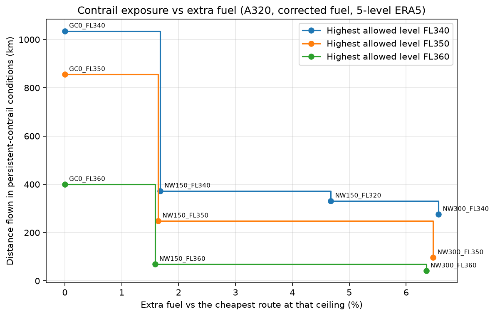
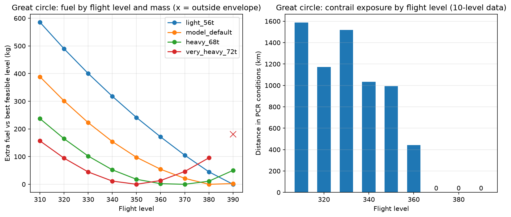
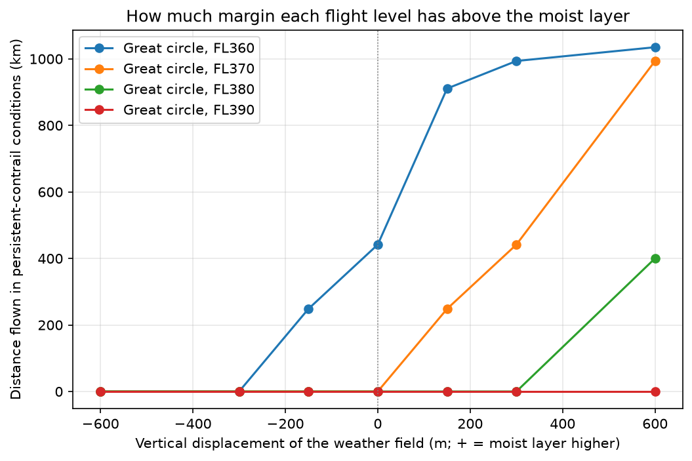

# robust-contrail-routing

[](https://github.com/bunluy/robust-contrail-routing/actions/workflows/tests.yml)

**How should an aircraft's cruise level and path be chosen to avoid creating persistent contrails, when the weather data behind that choice is uncertain, and what does planning for that uncertainty cost?**

An independent case study using ERA5 atmospheric reanalysis, the open-source contrail model [pycontrails](https://py.contrails.org) and the Poll–Schumann aircraft performance model. It evaluates 45 candidate routes for an A320-class flight under 18 weather-error scenarios and compares deterministic and robust ways of choosing between them.

> **Status:** Sessions 1–7 complete. Next: a route planner that searches the airspace (graph search) instead of choosing from a fixed set of routes, and repeating the study on several dates. See [Roadmap](#roadmap).

---

## Main findings

*Case study: a ~1,800 km night flight from (−10°, 45°) to (10°, 55°), 2022-03-01 00:00 UTC, A320, constant true airspeed 230 m/s, no wind.*

**1. Avoidance has steeply diminishing returns.** When the aircraft is held at or below FL360, bending the path 150 km towards the dry side of the moist band cuts the distance flown in persistent-contrail conditions by 83% (400 → 69 km) for **1.6% extra fuel** (79 kg). Going further, to 41 km, costs another 237 kg: about 35 times more per kilometre avoided.



**2. Aircraft weight decides whether there is a trade-off at all.** Heavier aircraft cruise most efficiently lower down, closer to or inside the moist layer:

| Start-of-cruise mass | Most fuel-efficient level | Contrail exposure there |
|---|---|---|
| 56 t | FL390 | 0 km |
| ≈64 t (model estimate) | FL380 | 0 km |
| 68 t | FL370 | 0 km |
| 72 t (near maximum) | FL350 | 994 km |



**3. Uncertainty in the *height* of the moist layer is what changes decisions.** Shifting the weather field up or down by 150–600 m changed which route the decision rules chose in 9 of 12 cases. Uniform humidity errors (1 of 9) and horizontal or timing shifts (1 of 18) rarely did. FL370 looked contrail-free, but only by a margin of less than 150 m.



**4. Planning for that uncertainty is cheap when the aircraft can climb.** A robust choice (minimising the worst case across scenarios) costs +2.5 kg (0.05%) at the model's default mass and +50 kg (≈1%) at 68 t, both by cruising at FL390. A near-full aircraft (72 t) cannot reach FL390; its robust choice combines FL380 with a 150 km detour, for +125 kg (≈2.2%), cutting its worst-case exposure from 994 km to 83 km.

These are results for **one flight on one night**. Whether they generalise is the subject of the next sessions.

---

## Why this matters

Persistent contrails form in thin, patchy layers of cold, ice-supersaturated air and can spread into cirrus-like clouds lasting hours. Their warming effect is estimated to be comparable to that of aviation's CO₂ (Lee et al., 2021), which makes small altitude or path changes a potentially cheap way to reduce aviation's climate impact (Teoh et al., 2020).

Two things make this an engineering decision problem rather than a physics one:

1. **Avoidance has a cost:** more distance, more fuel, more CO₂.
2. **The atmosphere is uncertain:** weather models struggle to locate ice-supersaturated air precisely, so a route that avoids contrails on paper may not do so in reality.

Operational trials have shown avoidance can work. EUROCONTROL's Maastricht centre used vertical clearances of up to 2,000 ft and identified the precision of meteorological tools as a key challenge ([EUROCONTROL, 2021](https://www.eurocontrol.int/press-release/mitigating-climate-impact-non-co2-emissions)), and Google Research, Breakthrough Energy and American Airlines reported large reductions in observed contrails ([Google Research](https://sites.research.google/gr/contrails/)). This project studies the decision those trials face, on a small and fully transparent scale.

---

## Method

```
candidate route (lateral offset, flight level)
  → ERA5 temperature and humidity (10 pressure levels, 175–300 hPa) along the path
  → pycontrails PCR model
       Schmidt–Appleman criterion: can a contrail form?
       ice supersaturation (RHi > 1): can it persist?
  → distance flown in persistent-contrail (PCR) conditions
  → Poll–Schumann model: fuel burn for the route
  → objective J = fuel + λ × PCR distance, over 18 weather-error scenarios
  → deterministic vs worst-case vs minimax-regret route choice
```

- **Routes:** the great circle and smooth lateral deviations of ±150 and ±300 km, at FL310–FL390 (45 routes). The set was fixed before any results were seen, so routes are not tuned to the data.
- **Uncertainty scenarios:** humidity scaled by −5% to +11%; the whole weather field displaced 50–100 km sideways, 100 km along-track or 1 h in time; and moved 150–600 m up or down.
- **λ** is the fuel (kg) an operator would spend to avoid 1 km of contrail-forming flight. It is kept as an explicit setting (0.1, 1, 10 kg/km) because converting contrail distance to climate impact needs a contrail climate model, which is future work.
- **Contrail metric:** distance in PCR conditions is a proxy for climate impact. It is more defensible here than in general because the flights are at night, when persistent contrails warm.

---

## Checks and corrections

The project's own checks caught several errors; each is documented in the notebook where it was found, and the evidence is kept.

| Problem | How it was caught | Fix |
|---|---|---|
| A cached ERA5 hour came back empty (twice) | Missing-value check before every evaluation | Cache file rebuilt; now automatic (`load_era5_checked`) |
| Relative humidity over water was read as if over ice | Recomputed RHi did not match the ISSR flag | RHi computed explicitly and checked against ISSR |
| First synthetic flight was ~3× too slow | Sanity check of speed | Realistic 230 m/s; exposure changed from 317 to 800 km |
| "Direct" route was not the shortest path | Left/right route lengths were asymmetric | Routes rebuilt around the great circle |
| Fuel model used a fixed engine efficiency left by the contrail model | New fuel code disagreed with the old by up to 171 kg | Fixed; Sessions 4–6 decisions recomputed (none changed) |
| Vertical shift also changed humidity | Physically implausible result | Relative humidity now moves with the air; covered by a test |

The package has **18 automated tests**, including PCR on artificial dry and supersaturated atmospheres, route geometry, the decision rules and the cache repair. Run them with `python -m pytest`.

---

## Limitations

- One city pair (synthetic endpoints), one date and one departure time.
- Cruise only: the extra fuel to climb to higher levels is not included, which favours high levels.
- Constant true airspeed rather than constant Mach number; no wind.
- Scenario sizes are sensitivity cases, not calibrated estimates of ERA5 error, and are weighted equally.
- PCR distance is a proxy for climate impact, not a radiative-forcing calculation.
- ERA5 humidity is used unscaled in the base case; ERA5 is known to under-represent ice supersaturation.

---

## Roadmap

- [x] Persistent-contrail modelling baseline and along-track variation (Sessions 1–2)
- [x] Candidate routes and altitude sweep (Session 3)
- [x] Fuel model, Pareto fronts and routing objective (Session 4)
- [x] Robustness to humidity, position and timing errors (Sessions 5–6)
- [x] Vertical resolution, vertical errors and aircraft mass (Session 7)
- [ ] Route planner: gridded contrail maps and a graph search over the airspace
- [ ] Robust planner, and the same study on several dates and real city pairs
- [ ] Short technical report

**Future work, beyond this project:** a contrail climate model (pycontrails' CoCiP) to turn λ into a physical quantity; ERA5's 10-member ensemble as a real measure of weather uncertainty; wind and climb phases.

---

## Repository structure

```
src/contrail_routing/      package: geometry, met (ERA5 loading and repair), evaluate (PCR),
                           performance (fuel), scenarios, decisions, config
tests/                     automated tests (pytest)
notebooks/
  01_baseline_and_along_track_pcr.ipynb   Sessions 1-2
  02_candidate_routes.ipynb               Session 3
  03_routing_objective.ipynb              Session 4
  04_humidity_uncertainty.ipynb           Session 5
  05_position_errors.ipynb                Session 6
  06_vertical_and_mass.ipynb              Session 7 (and corrected Session 4-6 fuel)
results/                   CSV outputs per session; figures/ holds all figures
```

## Reproducing

Developed with Python 3.13 on Windows; `requirements.txt` lists the key packages and versions (`requirements-lock-windows.txt` is the exact environment).

```bash
python -m venv .venv
.venv\Scripts\python.exe -m pip install -r requirements.txt
.venv\Scripts\python.exe -m pytest
```

The first ERA5 download per configuration takes 10–20 minutes and is cached on disk afterwards. Keep the cache enabled: without it, converting ERA5's 137 model levels to pressure levels happens in memory and exceeds a typical laptop's RAM.

---

## References

- Hersbach, H. et al. (2020). The ERA5 global reanalysis. *Quarterly Journal of the Royal Meteorological Society*, 146, 1999–2049.
- Lee, D. S. et al. (2021). The contribution of global aviation to anthropogenic climate forcing for 2000 to 2018. *Atmospheric Environment*, 244, 117834.
- Poll, D. I. A. and Schumann, U. (2021). An estimation method for the fuel burn and other performance characteristics of civil transport aircraft in the cruise. *The Aeronautical Journal*, 125.
- Schumann, U. (1996). On conditions for contrail formation from aircraft exhausts. *Meteorologische Zeitschrift*, 5, 4–23.
- Teoh, R. et al. (2020). Mitigating the climate forcing of aircraft contrails by small-scale diversions and technology adoption. *Environmental Science & Technology*, 54, 2941–2950.
- [pycontrails](https://github.com/contrailcirrus/pycontrails) (v0.63.3), Breakthrough Energy and Imperial College London.
- ERA5 accessed through Google's Analysis-Ready, Cloud-Optimized ERA5 dataset. Contains modified Copernicus Climate Change Service information.

---

## Author

Independent project by Baris Unluyildiz, BEng Aerospace Engineering student at the University of Manchester.
[LinkedIn](https://www.linkedin.com/in/baris-unluyildiz/) · Released under the MIT License.
