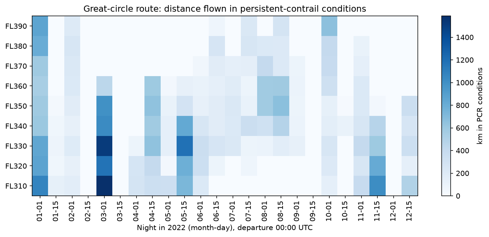
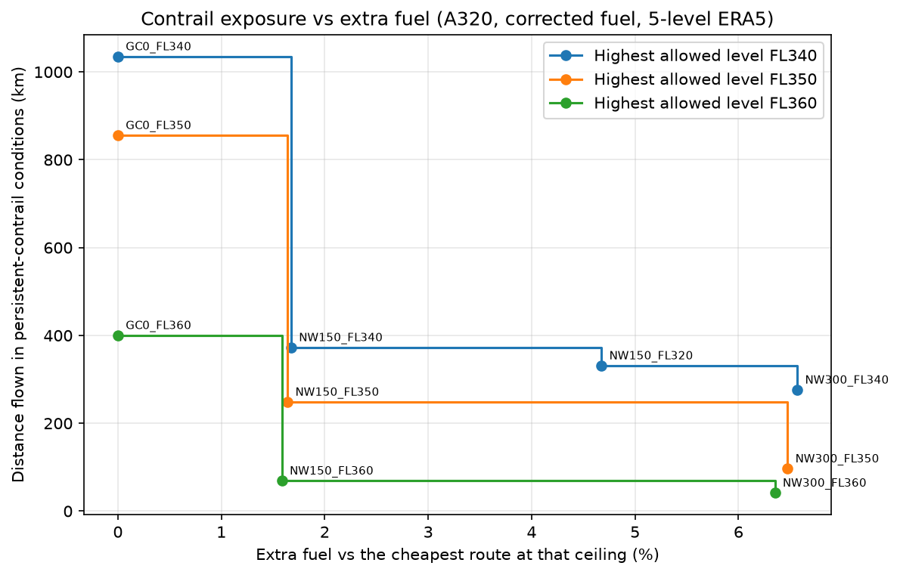
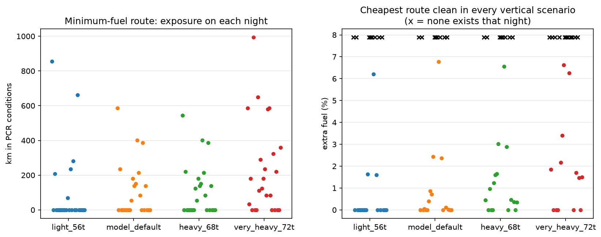
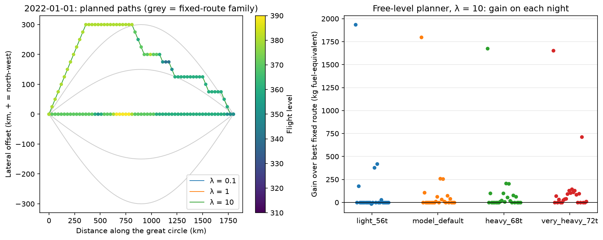
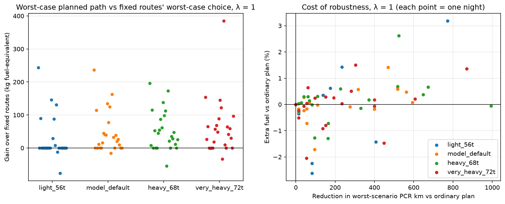
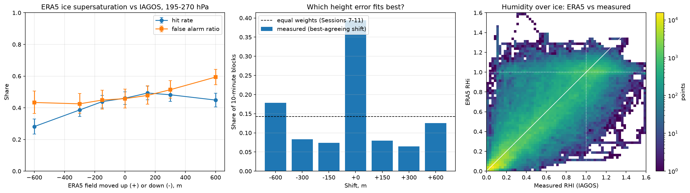
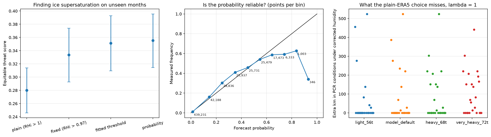

# robust-contrail-routing

[](https://github.com/bunluy/robust-contrail-routing/actions/workflows/tests.yml)

**How should an aircraft's cruise level and path be chosen to avoid creating persistent contrails, when the weather data behind that choice is uncertain, and what does planning for that uncertainty cost?**

An independent case study using ERA5 atmospheric reanalysis, the open-source contrail model [pycontrails](https://py.contrails.org) and the Poll–Schumann aircraft performance model. It evaluates 45 candidate routes for an A320-class flight under 18 weather-error scenarios, compares deterministic and robust ways of choosing between them, plans routes that hold up under those errors with an exact search written in C++, and tests ERA5's humidity against measurements made on board airliners (IAGOS).

> **Status:** Sessions 1–13 complete. One night (2022-03-01) studied in detail, the analysis repeated on 24 nights of 2022, a route planner compared with the fixed route set, an exact robust route search written in C++ run on all 24 nights, ERA5 checked against 786,845 humidity measurements from airliners (IAGOS), and ERA5's humidity corrected against those measurements. Next: robust routes using the measured corrections. See [Roadmap](#roadmap).

---

## Main findings

*Case study: a ~1,800 km night flight from (−10°, 45°) to (10°, 55°), A320, constant true airspeed 230 m/s, no wind, 45 candidate routes. Repeated on 24 nights of 2022 (the 1st and 15th of each month, 00:00 UTC), a rule fixed before any results were seen; 2022-03-01 is studied in the most detail.*

**1. Persistent-contrail conditions at cruise levels are common, and their height changes from night to night.** Every night had persistent-contrail (PCR) conditions on at least one route. On all six summer nights they reached FL370 or higher; on no spring night did they rise above FL360; winter and autumn were mixed. Climbing is therefore not a universal fix: the great-circle route at FL390 was itself exposed on 6 nights.



**2. Aircraft weight decides how often there is a trade-off.** Heavier aircraft cruise most efficiently lower down, closer to or inside the moist layer:

| Start-of-cruise mass | Most fuel-efficient level | Nights its route is exposed | ...or would be under a 150–600 m error in the layer's height |
|---|---|---|---|
| 56 t | FL390 | 6 of 24 | 11 of 24 |
| ≈64 t (model estimate) | FL370–FL380 | 11 of 24 | 17 of 24 |
| 68 t | FL360–FL370 | 12 of 24 | 19 of 24 |
| 72 t (near maximum) | FL350–FL360 | 17 of 24 | 19 of 24 |

**3. Avoidance is often affordable, but its cost varies widely between nights.** At the model-estimate mass, cutting exposure by at least 80% cost a median 1.2% extra fuel (up to 4.8%; not possible on 1 night). With the aircraft held at or below FL360, it cost a median 4.3% (up to 13.1%; not possible on 3 of 15 nights). The single-night figure that started this (an 83% cut for 1.6% on 2022-03-01) was at the cheap end.



**4. Uncertainty in the *height* of the moist layer changes route choices on most nights.** With the weather field shifted up or down by 150–600 m, deterministic, worst-case and minimum-regret rules chose different routes in 142 of 288 cases, on 19 of 24 nights. On 2022-03-01, height errors changed decisions far more often (9 of 12 cases) than uniform humidity errors (1 of 9) or horizontal and timing errors (1 of 18).

**5. A robust plan is usually cheap, but not always available.** The worst-case choice cost no extra fuel on a median night for every mass, and at most 1.6–6.3%. A route clear of contrail conditions under every height error existed on only 16 of 24 nights (13 for a 72 t aircraft); when it existed it cost a median 0–1.5% extra fuel, up to about 7%.



**6. A free-form route planner rarely beats the fixed route family.** A planner choosing any path through a grid of 25 lateral offsets × 9 flight levels × 60 stages found nothing better than the best of the 45 fixed routes on most nights (median gain 0). Freedom to change level helped heavier aircraft through step climbs (72 t: median 40 kg at λ = 1); large gains, up to ~1,900 kg fuel-equivalent at λ = 10, came from a few nights such as 1 January, when moist air sat at every level and only a long detour helped.



**7. Planning against height errors does beat the fixed routes, and robustness is usually free.** An exact search for the path whose worst case over the seven height scenarios is best (C++ core) beat the fixed routes' worst-case choice at λ = 1 on 16–18 of 24 nights for 64–72 t aircraft (median 23–45 kg fuel-equivalent) and on 7 nights for 56 t; it was worse on 1–2 nights per mass, by up to 76 kg. Against an ordinary plan for the weather as forecast, it cut worst-case contrail distance in 176 of 288 cases (median 55–117 km for 64–72 t) for a median 0.12% extra fuel, 69 of them at no extra fuel. 97% of the searches were solved exactly, half of them proved optimal by bounds alone; 16 of 576 hit the 2-minute limit and returned a path with a certified gap of 1.7–13.9% of fuel.



**8. Measured on board airliners, ERA5's main weakness is humidity, not height.** Against 786,845 measurements from 833 IAGOS flights over the study region in 2022 (175–300 hPa), ERA5 found 47% of the ice-supersaturated air, and 46% of what it showed was not measured (equitable threat score 0.29; best in winter, 0.44). Where the air was supersaturated, ERA5's relative humidity over ice was a median 0.99 against a measured 1.10: usually close, but just below saturation. Moving the ERA5 field up or down did not improve the agreement on average; no shift was the most common best fit (30–39% of 10-minute blocks), while shifts of about 600 m fitted best in at most about 30% (an upper bound: that share also includes moist layers ERA5 shows that are not there). So the height scenarios of Sessions 7–11 are realistic in size, but equal weights overstate the 150–300 m errors, and the results point to a humidity correction mattering more than a height correction.



**9. A one-number humidity correction finds far more of the supersaturated air and changes a quarter of route choices.** Tested on months it was not fitted to, calling ERA5 air supersaturated above 91% relative humidity over ice (instead of 100%) found 71% of the measured ice-supersaturated air instead of 46%, with the false alarm ratio rising only from 0.46 to 0.50 (ETS 0.35 against 0.28). The fitted value was 0.91–0.93 whichever month was left out, and lies inside the 85–95% range reported by Hildebrandt et al. (2026) for 2011–2022. A logistic model gave a probability that is reliable up to about 60% but no better yes/no answers. With the correction, contrail distance over the 45 routes rose 62%, and the lowest-cost route changed in 79 of 288 night × mass × λ cases (up to 11 of 24 nights for a 72 t aircraft). The plain-ERA5 choice would have flown up to 690 km through contrail conditions it did not see, while switching usually cost no extra fuel.



These results cover one city pair, one departure time and one year, and the corrections are fitted to four aircraft over one region.

---

## Why this matters

Persistent contrails form in thin, patchy layers of cold, ice-supersaturated air and can spread into cirrus-like clouds lasting hours. Their warming effect is estimated to be comparable to that of aviation's CO₂ (Lee et al., 2021), which makes small altitude or path changes a potentially cheap way to reduce aviation's climate impact (Teoh et al., 2020).

Two things make this an engineering decision problem rather than a physics one:

1. **Avoidance has a cost:** more distance, more fuel, more CO₂.
2. **The atmosphere is uncertain:** weather models struggle to locate ice-supersaturated air precisely, so a route that avoids contrails on paper may not do so in reality.

Operational trials have shown avoidance can work. EUROCONTROL's Maastricht centre used vertical clearances of up to 2,000 ft and identified the precision of meteorological tools as a key challenge ([EUROCONTROL, 2021](https://www.eurocontrol.int/press-release/mitigating-climate-impact-non-co2-emissions)), and Google Research, Breakthrough Energy and American Airlines reported large reductions in observed contrails ([Google Research](https://sites.research.google/gr/contrails/)). This project studies the decision those trials face, on a small and fully transparent scale.

---

## Method

```
candidate route (lateral offset, flight level)
  → ERA5 temperature and humidity (10 pressure levels, 175–300 hPa) along the path
  → pycontrails PCR model
       Schmidt–Appleman criterion: can a contrail form?
       ice supersaturation (RHi > 1): can it persist?
  → distance flown in persistent-contrail (PCR) conditions
  → Poll–Schumann model: fuel burn for the route
  → objective J = fuel + λ × PCR distance, over weather-error scenarios
  → deterministic vs worst-case vs minimax-regret route choice
  → repeated on 24 nights
  → route planner: dynamic programming over a stage × offset × flight-level grid,
    every planned path re-flown through the steps above
  → robust planner: exact search for the path that is best in the worst of the
    weather scenarios (C++ core, called from Python through pybind11), on 24 nights
  → ERA5 checked against IAGOS: the same steps evaluated at 786,845 points measured
    on board airliners, in the field as given and in every height-shifted field
```

- **Routes:** the great circle and smooth lateral deviations of ±150 and ±300 km, at FL310–FL390 (45 routes). The set was fixed before any results were seen, so routes are not tuned to the data.
- **Uncertainty scenarios:** on 2022-03-01, 18 scenarios: humidity scaled by −5% to +11%; the whole weather field displaced 50–100 km sideways, 100 km along-track or 1 h in time; and moved 150–600 m up or down. On all 24 nights, the vertical shifts (the ones that changed decisions).
- **λ** is the fuel (kg) an operator would spend to avoid 1 km of contrail-forming flight. It is kept as an explicit setting (0.1, 1, 10 kg/km) because converting contrail distance to climate impact needs a contrail climate model, which is future work.
- **Robust search:** labels (partial paths) that are not beaten on fuel and on contrail distance in every scenario, pruned by a lower bound per scenario and a Lagrangian bound (a weighted average of the scenarios never exceeds the worst one). When the bounds meet, the path is proved optimal without searching; when a time limit is reached, the best path found is returned with a certified gap. A pure-Python copy of the same algorithm checks the C++ step for step.
- **IAGOS comparison:** IAGOS-CORE L2 relative humidity over ice and temperature (every 4 s, quality-flagged good and final) inside the study region at 175–300 hPa, 2022. ERA5 is matched to each point through the route evaluation's own loader, levels, interpolation and PCR model; scores use whole flights as the independent units (bootstrap intervals). The rules were fixed in the notebook before any comparison was made.
- **Humidity correction:** four ways of calling ERA5 air ice-supersaturated (RHi > 1, RHi > 0.97, a fitted threshold, and a logistic probability from ERA5's humidity 0–600 m above and below the point, temperature and pressure), each tested on months it was not fitted to (leave-one-month-out), with paired comparisons over whole flights. The fitted threshold is applied to the routes through pycontrails' constant humidity scaling.
- **Contrail metric:** distance in PCR conditions is a proxy for climate impact. It is more defensible here than in general because the flights are at night, when persistent contrails warm.

---

## Checks and corrections

The project's own checks caught several errors; each is documented in the notebook where it was found, and the evidence is kept.

| Problem | How it was caught | Fix |
|---|---|---|
| A cached ERA5 hour came back empty (twice) | Missing-value check before every evaluation | Cache file rebuilt; now automatic (`load_era5_checked`) |
| Relative humidity over water was read as if over ice | Recomputed RHi did not match the ISSR flag | RHi computed explicitly and checked against ISSR |
| First synthetic flight was ~3× too slow | Sanity check of speed | Realistic 230 m/s; exposure changed from 317 to 800 km |
| "Direct" route was not the shortest path | Left/right route lengths were asymmetric | Routes rebuilt around the great circle |
| Fuel model used a fixed engine efficiency left by the contrail model | New fuel code disagreed with the old by up to 171 kg | Fixed; Sessions 4–6 decisions recomputed (none changed) |
| Vertical shift also changed humidity | Physically implausible result | Relative humidity now moves with the air; covered by a test |
| Route planner underestimated contrail distance by up to 308 km | Every planned path re-flown through the full pipeline | Planner re-times the weather along its own path and samples each step at 3 points; worst error now 70 km |
| Robust search blew up for heavy aircraft (millions of partial paths) | Search size and time logged for every search on real data | Tighter joint and Lagrangian bounds (a stress case went from over 2 minutes to 0.01 s); a time limit that returns a certified gap instead of failing |

The IAGOS matching is checked by temperature: ERA5 and the measured temperature agree to −0.48 K on average (sd 0.80 K) in every season, which rules out a mismatch in time, position or pressure before any humidity result is read.

Each new step is also checked against the previous one: the multi-night code reproduces the single-night results exactly before it is run on other nights.

The package has **112 automated tests**, including PCR on artificial dry and supersaturated atmospheres, route geometry, the decision rules, the cache repair, the route planner checked against brute force over every possible path on small grids, and the C++ robust search checked against brute force, against a pure-Python version of the same algorithm, and for the validity of the gap it reports when stopped early, the IAGOS reading, quality filters and ERA5 matching on artificial files and atmospheres, and the calibration tools (including a check that a month's own measurements can never affect its out-of-month prediction). They run on GitHub on every push (badge at the top); locally, run `python -m pytest`.

---

## Limitations

- One city pair (synthetic endpoints), one departure time (00:00 UTC) and 24 nights of one year: too few for firm seasonal conclusions.
- Cruise only: the extra fuel to climb to higher levels is not included, which favours high levels.
- Constant true airspeed rather than constant Mach number; no wind.
- The route planner's grid is limited to ±300 km, and its fuel per km does not fall as the aircraft gets lighter. Robust searches are exact on that grid only; 16 of 576 stopped at the time limit with a certified gap of up to 13.9% of fuel.
- Planned paths optimise the planner's own estimate, which differs from the full pipeline by up to 70 km of contrail distance; at λ = 10 this caused some of the cases where a planned path lost to a fixed route.
- Scenario sizes are sensitivity cases weighted equally. The IAGOS comparison (Session 12) supports their range but not equal weights, and suggests ERA5's humidity errors near saturation matter more than its height errors; the routing does not yet use these findings. Only the vertical scenarios were repeated on all 24 nights.
- The IAGOS sample comes from 4 aircraft based at Frankfurt and Paris, with few flights in March and April; measured humidity has its own uncertainty (about ±0.13 near saturation), and climbs and descents disagree in a way that suggests a sensor effect.
- PCR distance is a proxy for climate impact, not a radiative-forcing calculation.
- ERA5 humidity is used unscaled in Sessions 1–11. Session 13 shows a measured correction (RHi > 0.91) changes about a quarter of route choices; it was fitted at about FL340–FL390 and assumes one threshold for all seasons, and with the threshold chosen for the best ETS it marks more air as supersaturated than was measured (17% against 12%), so its effect on routes is an upper estimate.

---

## Roadmap

- [x] Persistent-contrail modelling baseline and along-track variation (Sessions 1–2)
- [x] Candidate routes and altitude sweep (Session 3)
- [x] Fuel model, Pareto fronts and routing objective (Session 4)
- [x] Robustness to humidity, position and timing errors (Sessions 5–6)
- [x] Vertical resolution, vertical errors and aircraft mass (Session 7)
- [x] The same analysis on 24 nights of 2022 (Session 8)
- [x] Route planner over the airspace, compared with the fixed route set (Session 9)
- [x] Robust planner: an exact search core in C++ (pybind11), validated against brute force and a pure-Python version (Session 10)
- [x] Robust planned routes under vertical weather errors on 24 nights, and a benchmark against the pure-Python version (Session 11)
- [x] How often does ERA5 miss ice supersaturation? A comparison with humidity measured on board airliners (IAGOS) (Session 12)
- [x] A statistical correction of ERA5 humidity giving a calibrated probability of ice supersaturation, compared with existing humidity scalings, and its effect on route choices (Session 13)
- [ ] Robust route choice with weather-error scenarios calibrated against those measurements
- [ ] Short technical report

**Future work, beyond this project:** a contrail climate model (pycontrails' CoCiP) to turn λ into a physical quantity; ERA5's 10-member ensemble; wind, climb and real city pairs.

---

## Repository structure

```
src/contrail_routing/      package: geometry, met (ERA5 loading and repair), evaluate (PCR),
                           performance (fuel), scenarios, decisions, planner, robust,
                           iagos (reading IAGOS and matching ERA5), calibration (humidity
                           corrections tested on unseen months), config
cpp/                       C++ core of the robust search (robust_search.cpp) and its build files
tests/                     automated tests (pytest)
notebooks/
  01_baseline_and_along_track_pcr.ipynb   Sessions 1-2
  02_candidate_routes.ipynb               Session 3
  03_routing_objective.ipynb              Session 4
  04_humidity_uncertainty.ipynb           Session 5
  05_position_errors.ipynb                Session 6
  06_vertical_and_mass.ipynb              Session 7 (and corrected Session 4-6 fuel)
  07_multiple_dates.ipynb                 Session 8: 24 nights of 2022
  08_route_planner.ipynb                  Session 9: route planner vs the fixed route set
  09_robust_search.ipynb                  Session 10: robust search, checks and speed on one night
  10_robust_24_nights.ipynb               Session 11: robust planned routes on 24 nights
  11_era5_vs_iagos.ipynb                  Session 12: ERA5 checked against IAGOS measurements
  12_correcting_era5_humidity.ipynb       Session 13: humidity corrections and their effect on routes
scripts/download_era5_dates.py            downloads and checks ERA5 for the 24 nights
scripts/match_era5_to_iagos.py            matches ERA5 to every IAGOS measurement (resumable)
results/                   CSV outputs per session (IAGOS: summary tables only); figures/ holds all figures
```

## Reproducing

Developed with Python 3.13 on Windows; `requirements.txt` lists the key packages and versions (`requirements-lock-windows.txt` is the exact environment). Building the C++ core needs a C++ compiler: on Windows, the Microsoft C++ Build Tools ("Desktop development with C++"); on Linux or macOS, the system compiler. Without it everything else still runs, and the robust search falls back to its (much slower) pure-Python version.

```bash
python -m venv .venv
.venv\Scripts\python.exe -m pip install -r requirements.txt
.venv\Scripts\python.exe -m pip install --no-build-isolation ./cpp
.venv\Scripts\python.exe -m pytest
```

The first ERA5 download per configuration takes 10–20 minutes and is cached on disk afterwards; for notebooks 07–10, run `scripts/download_era5_dates.py` first (about 2 hours and 13 GB for the 24 nights). Notebook 10 then takes about 75 minutes and saves each night as it finishes, so it can be stopped and resumed. Keep the cache enabled: without it, converting ERA5's 137 model levels to pressure levels happens in memory and exceeds a typical laptop's RAM.

For notebook 11, IAGOS data are needed; they are not included here, to keep the repository small (about 650 MB for 2022). Register at the [IAGOS Data Portal](https://iagos.aeris-data.fr/), then download IAGOS-CORE L2 time series in NetCDF for 2022-01-01 to 2023-01-01 over 40–60°N, 20°W–20°E (the optional ECMWF ancillary data must be left unticked, or the download fails). Put the files in `iagos_data` in your home folder (or set `IAGOS_DATA`) and run `scripts/match_era5_to_iagos.py <that folder>`: about 24 hours, resumable, deleting each ERA5 hour once matched. Notebook 12 then uses those matched points and the cached ERA5 of the 24 study nights (a few minutes).

---

## Related work

Recent studies have compared ERA5 with IAGOS humidity; this project's own comparison (Sessions 12–13) agrees with them where they overlap and adds the step they do not take, the effect on route decisions. Hildebrandt et al. (2026) found an ETS of 0.2–0.4 for ERA5 ice supersaturation over 2011–2022 and better detection with RHi thresholds of 85–95%; Antonopoulos et al. (2026) corrected ERA5 humidity with machine learning (ETS 0.36 to 0.44); Driver et al. (2025) showed the errors are structured by the weather situation around extratropical depressions; Reutter et al. (2020) found ERA-Interim underestimates ice supersaturation in number and strength. (Summarised from the published abstracts.)

---

## References

- Antonopoulos, M., Juvin-Quarroz, J., & Boucher, O. (2026). Technical note: Hybrid machine learning model for bias correction of UTLS relative humidity against IAGOS observations in ERA5 reanalysis. *Atmospheric Chemistry and Physics*. https://doi.org/10.5194/acp-26-4771-2026
- Driver, O. G. A., Stettler, M. E. J., & Gryspeerdt, E. (2025). The ice supersaturation biases limiting contrail modelling are structured around extratropical depressions. *Atmospheric Chemistry and Physics*. https://doi.org/10.5194/acp-25-16411-2025
- Hersbach, H. et al. (2020). The ERA5 global reanalysis. *Quarterly Journal of the Royal Meteorological Society*, 146, 1999–2049.
- Hildebrandt, K. G., Castino, F., Meijer, V., & Yin, F. (2026). Variability of ice supersaturated regions at flight altitudes: evaluation of ERA5 reanalysis using IAGOS in situ measurements. *Atmospheric Chemistry and Physics*. https://doi.org/10.5194/acp-26-6449-2026
- Lee, D. S. et al. (2021). The contribution of global aviation to anthropogenic climate forcing for 2000 to 2018. *Atmospheric Environment*, 244, 117834.
- Poll, D. I. A. and Schumann, U. (2021). An estimation method for the fuel burn and other performance characteristics of civil transport aircraft in the cruise. *The Aeronautical Journal*, 125.
- Reutter, P., Neis, P., Rohs, S., & Sauvage, B. (2020). Ice supersaturated regions: properties and validation of ERA-Interim reanalysis with IAGOS in situ water vapour measurements. *Atmospheric Chemistry and Physics*, 20. https://doi.org/10.5194/acp-20-787-2020
- Schumann, U. (1996). On conditions for contrail formation from aircraft exhausts. *Meteorologische Zeitschrift*, 5, 4–23.
- Teoh, R. et al. (2020). Mitigating the climate forcing of aircraft contrails by small-scale diversions and technology adoption. *Environmental Science & Technology*, 54, 2941–2950.
- [pycontrails](https://github.com/contrailcirrus/pycontrails) (v0.63.3), Breakthrough Energy and Imperial College London.
- ERA5 accessed through Google's Analysis-Ready, Cloud-Optimized ERA5 dataset. Contains modified Copernicus Climate Change Service information.
- Boulanger, D., Blot, R., Bundke, U., Gerbig, C., Hermann, M., Nédélec, P., Rohs, S., & Ziereis, H. (2018). *IAGOS final quality controlled Observational Data L2 – Time series* [Dataset]. Aeris. https://doi.org/10.25326/06. From the [IAGOS Data Portal](https://iagos.aeris-data.fr/) (see there for updates), licensed under [CC BY 4.0](https://creativecommons.org/licenses/by/4.0/). Changes made here: quality-filtered, cut to the study region and 175–300 hPa, and compared with ERA5; only summary tables are published. See the [IAGOS data policy](https://iagos.aeris-data.fr/data-policy/).

---

## Acknowledgements

“MOZAIC/CARIBIC/IAGOS data were created with support from the European Commission, national agencies in Germany (BMBF), France (MESR), and the UK (NERC), and the IAGOS member institutions (http://www.iagos.org/partners). The participating airlines (Lufthansa, Air France, Austrian, China Airlines, Hawaiian Airlines, Air Canada, Iberia, Eurowings Discover, Cathay Pacific, Air Namibia, Sabena) supported IAGOS by carrying the measurement equipment free of charge since 1994. The data are available at http://www.iagos.fr thanks to additional support from AERIS.”

---

## Author

Independent project by Baris Unluyildiz, BEng Aerospace Engineering student at the University of Manchester.
[LinkedIn](https://www.linkedin.com/in/baris-unluyildiz/) · Released under the MIT License.
